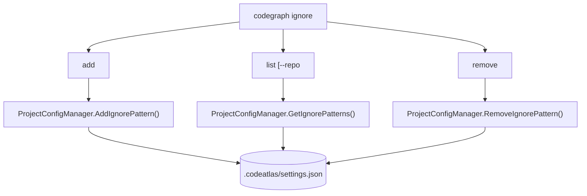

# Feature Implementation Plan: CLI Ignore Management (`codegraph ignore`)

**Plan Version:** 1.0 (Model Tag: `g37`)  
**Status:** Proposed / Ready for Review  
**Target Projects:** `CodeAtlas.Core`, `CodeAtlas.Cli`, `CodeAtlas.Tests`

---

## 1. Executive Summary & Objective

Provide a first-class CLI command group (`codegraph ignore`) enabling developers and autonomous AI coding agents to inspect, add, and remove project-level file and directory ignore patterns without manual edits to `.codeatlas/settings.json`.

### Core Goals
1. **Agent Usability**: Give AI agents a clean, structured CLI interface (`codegraph ignore add|list|remove`) to suppress test fixtures, minified bundles, or large mock datasets during automated workflows.
2. **Schema & Configuration Preservation**: Intelligently read and mutate `.codeatlas/settings.json` using JSON DOM (`System.Text.Json.Nodes.JsonNode`), ensuring that pre-existing custom properties (parsers, databases, schemas) and formatting are preserved without destruction.
3. **Cross-Platform Glob Normalization**: Normalize paths and glob delimiters (`\` to `/`), deduplicate patterns (case-insensitive), and trim whitespace.
4. **Zero Configuration Friction**: Automatically create the `.codeatlas` directory and `settings.json` if they do not yet exist upon adding a rule.

---

## 2. CLI Command Suite Specification

The CLI group `codegraph ignore` will be registered under the root CLI application with three subcommands: `add`, `list` (alias `ls`), and `remove` (alias `rm`).



### 2.1. `codegraph ignore add`
Adds one or more glob patterns or file paths to `.codeatlas/settings.json`.

* **Syntax**: `codegraph ignore add <pattern> [--repo|-r|--root <path>]`
* **Arguments**:
  * `pattern` (Required, `string`): The file path or glob expression to ignore (e.g. `tests/fixtures/**`, `*.generated.cs`, `build/output/*`).
* **Options**:
  * `--repo` / `-r` / `--root` (Optional, `DirectoryInfo?`): Target repository path (defaults to auto-detected git root or current working directory).
* **Behavior**:
  1. Normalizes pattern (`\` to `/`, trims whitespace).
  2. Rejects null/empty patterns with an error message and exit code `1`.
  3. Checks for duplicates (case-insensitive).
  4. If already present: Emits `Pattern '<pattern>' is already in ignore list.` (exit code `0`).
  5. If new: Appends pattern to `ignorePatterns` array, saves `.codeatlas/settings.json`, and emits `Added ignore pattern '<pattern>' to .codeatlas/settings.json` (exit code `0`).

### 2.2. `codegraph ignore list` (alias: `ls`)
Displays all active project-level ignore patterns defined in `.codeatlas/settings.json`.

* **Syntax**: `codegraph ignore list [--repo|-r|--root <path>] [--json]`
* **Options**:
  * `--repo` / `-r` / `--root` (Optional, `DirectoryInfo?`): Target repository path.
  * `--json` (Optional, `bool`): Output list as machine-readable JSON array.
* **Output Format**:
  * **Standard Console**:
    ```text
    Active Ignore Patterns (3):
      - tests/fixtures/**
      - *.generated.cs
      - src/Legacy/**/*.js
    ```
    *(If no patterns exist: `No custom ignore patterns configured in .codeatlas/settings.json`)*
  * **JSON Mode (`--json`)**:
    ```json
    {
      "repoPath": "D:/Projects/C#/CodeAtlas",
      "settingsPath": "D:/Projects/C#/CodeAtlas/.codeatlas/settings.json",
      "ignorePatterns": [
        "tests/fixtures/**",
        "*.generated.cs",
        "src/Legacy/**/*.js"
      ]
    }
    ```

### 2.3. `codegraph ignore remove` (alias: `rm`)
Removes an existing ignore pattern from `.codeatlas/settings.json`.

* **Syntax**: `codegraph ignore remove <pattern> [--repo|-r|--root <path>]`
* **Arguments**:
  * `pattern` (Required, `string`): Pattern to remove.
* **Options**:
  * `--repo` / `-r` / `--root` (Optional, `DirectoryInfo?`): Target repository path.
* **Behavior**:
  1. Normalizes pattern for lookup.
  2. Searches existing patterns (case-insensitive).
  3. If not found: Emits `Pattern '<pattern>' not found in ignore configuration.` (exit code `0` or `1`).
  4. If found: Removes item, writes updated JSON, and emits `Removed pattern '<pattern>' from .codeatlas/settings.json` (exit code `0`).

---

## 3. Configuration & JSON DOM Preservation Architecture

### Storage Target
* **File Path**: `<repoRoot>/.codeatlas/settings.json`
* **Fallback & Compatibility**: `AppConfig` in `CodeAtlas.Core` already reads `.codeatlas/settings.json` and respects both `ignorePatterns` and `IgnorePatterns` / `IgnoreDirectories`.

### Default Schema & Template
When `.codeatlas/settings.json` does not exist, `ProjectConfigManager` creates it with the canonical structure:
```json
{
  "$schema": "https://raw.githubusercontent.com/scriptedfluff/codegraphmcp/main/schema.json",
  "version": 1,
  "ignorePatterns": [
    "tests/fixtures/**"
  ]
}
```

### JSON Node Preservation Strategy
To prevent destroying custom configuration keys (e.g. `IgnoreDirectories`, `IncludePatterns`, parser overrides, or custom tool settings), the config service will utilize `System.Text.Json.Nodes.JsonNode` / `JsonObject`:
1. If file exists, parse into `JsonObject` via `JsonNode.Parse(rawText)`.
2. Locate existing property: inspect for `ignorePatterns` (camelCase) or `IgnorePatterns` (PascalCase).
3. If property exists as `JsonArray`, manipulate the elements.
4. If property does not exist, add `"ignorePatterns": JsonArray`.
5. Serialize back using `JsonSerializerOptions { WriteIndented = true }` with UTF-8 encoding.

---

## 4. Architectural Components & Code Layout

```
src/
├── CodeAtlas.Core/
│   └── Config/
│       ├── ProjectConfigManager.cs    [NEW] Service for reading, mutating, and writing project settings
│       └── AppConfig.cs               [EXISTING] Runtime config loader (already supports settings.json)
└── CodeAtlas.Cli/
    └── Commands/
        ├── IgnoreCommandHandler.cs    [NEW] CLI command definition and command execution logic
        └── CommandFactory.cs          [MODIFY] Register 'ignore' command group under RootCommand
tests/
└── CodeAtlas.Tests/
    ├── ProjectConfigManagerTests.cs   [NEW] Unit tests for config mutation, normalization, and preservation
    └── IgnoreCommandTests.cs          [NEW] Integration tests for CLI command invocations
```

---

## 5. Detailed Component Specifications

### 5.1. `ProjectConfigManager` (`CodeAtlas.Core/Config/ProjectConfigManager.cs`)
Core static service handling configuration mutation with thread-safety and validation.

```csharp
namespace CodeAtlas.Core.Config;

public static class ProjectConfigManager
{
    public static string GetSettingsPath(string repoRoot);
    public static string NormalizePattern(string pattern);
    public static IReadOnlyList<string> GetIgnorePatterns(string repoRoot);
    
    public static ConfigMutationResult AddIgnorePattern(string repoRoot, string pattern);
    public static ConfigMutationResult RemoveIgnorePattern(string repoRoot, string pattern);
}

public sealed record ConfigMutationResult(
    bool Changed,
    bool AlreadyExisted,
    bool NotFound,
    string NormalizedPattern,
    string SettingsPath,
    string Message
);
```

#### Key Logic Details
* **Normalization**:
  ```csharp
  public static string NormalizePattern(string pattern)
  {
      if (string.IsNullOrWhiteSpace(pattern)) return string.Empty;
      return pattern.Trim().Replace('\\', '/');
  }
  ```
* **Preservation**:
  Uses `JsonNode.Parse` to parse existing text. Preserves comment handling (skips comments during parse or uses permissive options) and preserves all sibling JSON properties.

### 5.2. `IgnoreCommandHandler` (`CodeAtlas.Cli/Commands/IgnoreCommandHandler.cs`)
Defines the `Command` hierarchy using `System.CommandLine`.

* Resolves repository root directory using `repoOption ?? FindGitRoot(Directory.GetCurrentDirectory()) ?? Directory.GetCurrentDirectory()`.
* Formats standard text output with ANSI-clean, deterministic summaries.
* Implements `--json` output serializing `IgnoreListCliResponse` for agent interoperability.

### 5.3. `CommandFactory.cs` Registration
In `CreateRootCommand()`:
```csharp
rootCommand.AddCommand(IgnoreCommandHandler.CreateIgnoreCommand());
```

---

## 6. Verification & Test Plan

### 6.1. Unit Testing Matrix (`ProjectConfigManagerTests.cs`)
1. **`AddPattern_WhenFileDoesNotExist_CreatesDirectoryAndValidJson`**:
   * Creates temporary test folder.
   * Invokes `AddIgnorePattern(tempDir, "tests/fixtures/**")`.
   * Asserts `.codeatlas/settings.json` is created, contains `tests/fixtures/**`, valid JSON, and schema key.
2. **`AddPattern_NormalizesBackslashesAndWhitespace`**:
   * Input: `"  src\\generated\\*.cs  "`.
   * Asserts stored pattern is `"src/generated/*.cs"`.
3. **`AddPattern_DeduplicatesCaseInsensitively`**:
   * Adds `"*.min.js"`, then adds `"*.MIN.JS"`.
   * Asserts array contains only 1 entry; returns `AlreadyExisted = true`.
4. **`AddPattern_PreservesExistingCustomSettings`**:
   * Pre-populates `settings.json` with `{"version": 2, "customSetting": "active", "ignorePatterns": ["foo"]}`.
   * Adds `"bar"`.
   * Asserts `customSetting` remains `"active"`, `version` remains `2`, and `ignorePatterns` contains `["foo", "bar"]`.
5. **`RemovePattern_ExistingPattern_RemovesAndSaves`**:
   * Pre-populates with `["foo/**", "bar/**"]`.
   * Removes `"foo/**"`.
   * Asserts only `bar/**` remains.
6. **`RemovePattern_NonExistentPattern_ReturnsNotFound`**:
   * Removes non-existent pattern without modifying file.

### 6.2. CLI End-to-End Tests (`IgnoreCommandTests.cs`)
1. **`IgnoreAdd_CliInvoke_ReturnsZeroAndUpdatesFile`**:
   * Invokes root command with `new[] { "ignore", "add", "*.log", "-r", tempDir }`.
   * Asserts exit code `0` and file updated.
2. **`IgnoreList_CliInvoke_OutputsPatterns`**:
   * Invokes `new[] { "ignore", "list", "-r", tempDir }`.
   * Captures console output and verifies bulleted list.
3. **`IgnoreList_JsonFlag_OutputsValidJson`**:
   * Invokes `new[] { "ignore", "list", "-r", tempDir, "--json" }`.
   * Deserializes console output to verify JSON schema.
4. **`IgnoreRemove_CliInvoke_RemovesPattern`**:
   * Invokes `new[] { "ignore", "remove", "*.log", "-r", tempDir }`.
   * Asserts exit code `0` and pattern removed.

### 6.3. Indexing Integration Verification
* Verify that adding a pattern via `codegraph ignore add "Fixtures/**"` causes subsequent `index` or `IndexOrchestrator.EnumerateFiles` to automatically exclude matching fixture files.

---

## 7. Implementation Checklist & Timeline

- [x] **Phase 1: Core Configuration Service**
  - Implement `ProjectConfigManager` in `CodeAtlas.Core/Config/ProjectConfigManager.cs`.
  - Add unit tests in `ProjectConfigManagerTests.cs`.
- [x] **Phase 2: CLI Command Handler & Wiring**
  - Implement `IgnoreCommandHandler` in `CodeAtlas.Cli/Commands/IgnoreCommandHandler.cs`.
  - Register `CreateIgnoreCommand()` in `CommandFactory.cs`.
  - Add CLI integration tests in `IgnoreCommandTests.cs`.
- [x] **Phase 3: End-to-End Verification**
  - Run full test suite (`dotnet test`).
  - Verify CLI executable build and command execution against a test project.
