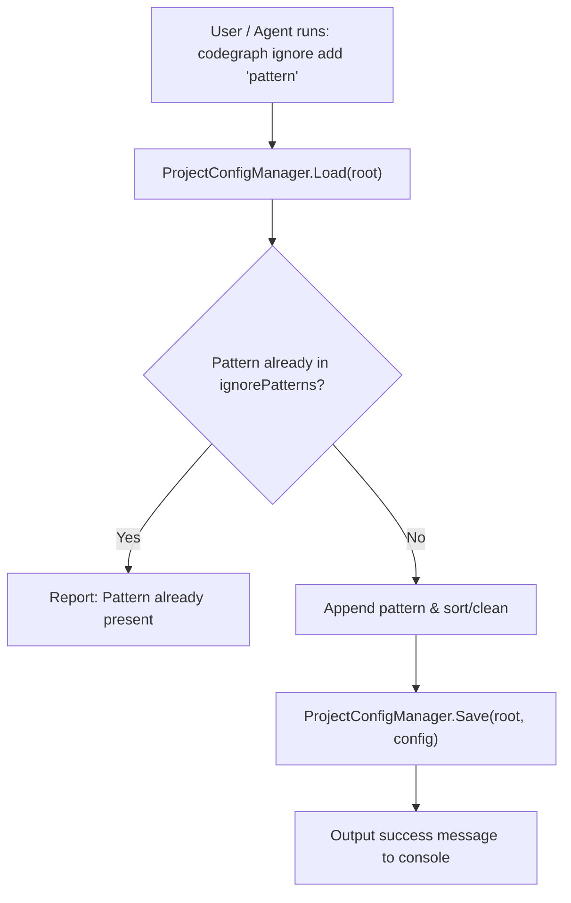

# Feature Specification: CLI Ignore Management (`codegraph ignore`)

## 1. Overview & Objective

Provide a dedicated CLI command suite (`codegraph ignore`) that allows developers and AI coding agents to inspect, add, and remove project-level file and directory ignore rules without manually editing `.codegraph/settings.json`.

This feature resides exclusively in the CLI project (`CodeGraphMcp`) while reading and updating the shared configuration format used by the core indexing and file watching engines.

---

## 2. CLI Command Suite & Usage

### 2.1. Add Ignore Patterns (`codegraph ignore add`)
Appends one or more glob patterns or file paths to the project configuration.

```bash
# Ignore specific directories or glob expressions
codegraph ignore add "tests/fixtures/**"
codegraph ignore add "*.generated.cs"
codegraph ignore add "src/Legacy/**/*.js"

# Specify a custom repository root (defaults to current working directory)
codegraph ignore add "build/**" --root ./my-project
```

### 2.2. List Ignore Patterns (`codegraph ignore list`)
Displays all active project-level ignore rules.

```bash
codegraph ignore list
# Output:
# Active Ignore Patterns (3):
#   - tests/fixtures/**
#   - *.generated.cs
#   - src/Legacy/**/*.js
```

### 2.3. Remove Ignore Patterns (`codegraph ignore remove`)
Removes an existing pattern from the configuration.

```bash
codegraph ignore remove "*.generated.cs"
# Output:
# Removed pattern '*.generated.cs' from .codegraph/settings.json
```

---

## 3. Configuration Storage Format

The CLI commands read from and write to `.codegraph/settings.json` at the project root.

```json
{
  "$schema": "https://raw.githubusercontent.com/scriptedfluff/codegraphmcp/main/schema.json",
  "version": 1,
  "ignorePatterns": [
    "tests/fixtures/**",
    "*.generated.cs",
    "src/Legacy/**/*.js"
  ]
}
```

### File & Directory Lifecycle
1. If the `.codegraph/` directory does not exist, it is automatically created.
2. If `settings.json` does not exist, a default structure containing the `ignorePatterns` array is created.
3. If `settings.json` exists, non-ignore configuration keys (e.g., custom parsers, DB paths) are strictly preserved during formatting and writing.

---

## 4. Normalization & Validation Rules

- **Path Normalization**: Backslashes (`\`) are normalized to forward slashes (`/`) for cross-platform glob consistency.
- **Deduplication**: Case-insensitive check prevents duplicate patterns from being added.
- **Whitespace / Empty**: Leading and trailing whitespaces are trimmed; empty or null patterns are rejected with an informative error.
- **Formatting**: Output JSON is formatted with standard 2-space indentation.

---

## 5. Architecture & Execution Flow



---

## 6. Target Implementation Files

| Component | Target File | Description |
|---|---|---|
| **CLI Command Handler** | `src/CodeGraphMcp/Commands/IgnoreCommand.cs` | Parses CLI subcommands (`add`, `remove`, `list`) and arguments. |
| **Config Service** | `src/CodeGraphMcp.Core/Config/ProjectConfigManager.cs` | Reads, validates, mutates, and serializes `.codegraph/settings.json`. |
| **Program Entry Point** | `src/CodeGraphMcp/Program.cs` | Registers the `ignore` command group in the CLI runner. |

---

## 7. Benefits
- **Agent Friendly**: AI agents can execute a clean CLI command when they encounter test fixtures, generated files, or noisy folders without writing custom JSON parsing scripts.
- **Zero Syntax Errors**: Avoids manual JSON syntax mistakes (missing commas, invalid escapes).
- **Deterministic**: Ensures glob rules are normalized consistently across Windows, macOS, and Linux.
