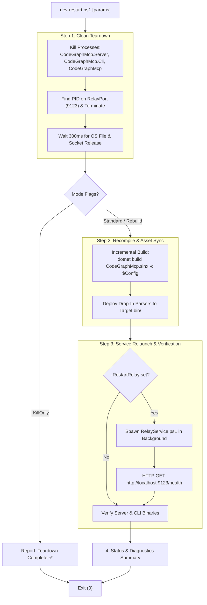

# Feature Specification & Plan: Developer Inner-Loop & Clean Teardown Utility (`dev-restart`)

**Plan Version:** 1.0 (Model Tag: `g37`)  
**Status:** Proposed / Ready for Review  
**Target Scripts:** `scripts/dev-restart.ps1`, `.vscode/tasks.json`  
**Target Projects:** `CodeGraphMcp.Server`, `CodeGraphMcp.Cli`, `CodeGraphMcp.Core`, `CodeGraphMcp.Parsers.*`

---

## 1. Executive Summary & Problem Statement

When actively developing and dogfooding **CodeGraphMcp** within an IDE (VS Code / Antigravity) or agent harness, running background processes frequently lock compiled binaries (`bin/` DLLs, PDBs) and SQLite database files. This causes `dotnet build` to fail with:
```text
MSB3027: The process cannot access the file because it is being used by another process.
```

Furthermore, the inter-agent relay service running on port `9123` can become orphaned or hold stale in-memory state during rapid iterative coding.

### Key Objectives
1. **Zero Lock Collisions**: Ensure all running server, CLI, and relay processes are safely and reliably terminated before recompilation.
2. **Sub-Second Rebuild & Hot Reload**: Provide an optimized build cycle that compiles `CodeGraphMcp.slnx` and copies dynamic drop-in parser plugins without full rebuild overhead unless requested.
3. **Automated Daemon Management**: Cleanly tear down and resurrect the `CodeGraph Relay Daemon` (port `9123`) with health-check confirmation.
4. **IDE & CLI First-Class Experience**: Provide simple CLI parameterization (`-KillOnly`, `-RestartRelay`, `-Publish`, `-Configuration`) and VS Code task integration for single-hotkey restart.

---

## 2. Dev Cycle & Execution Flow



---

## 3. PowerShell Script Specification (`scripts/dev-restart.ps1`)

```powershell
<#
.SYNOPSIS
    Fast developer inner-loop teardown, rebuild, and service restart script for CodeGraphMcp.
.DESCRIPTION
    Safely terminates running CodeGraphMcp server, CLI, and relay instances to release file/socket
    locks, rebuilds the solution and parser plugins, and optionally restarts the relay daemon.
.PARAMETER Configuration
    Build configuration (Debug or Release). Default is Debug.
.PARAMETER NoBuild
    Skips the dotnet build step and only performs process cleanup / service relaunch.
.PARAMETER KillOnly
    Terminates all active processes and port listeners, then exits immediately.
.PARAMETER RestartRelay
    Launches a fresh CodeGraph Relay daemon on the specified RelayPort after build.
.PARAMETER Publish
    Executes a full publish pass via scripts/publish.ps1 instead of standard incremental build.
.PARAMETER RelayPort
    Port used by the Relay service. Default is 9123.
.EXAMPLE
    .\scripts\dev-restart.ps1
    # Standard fast inner-loop: kills locks, incremental build Debug, verifies output.
.EXAMPLE
    .\scripts\dev-restart.ps1 -RestartRelay
    # Kills locks, builds solution, and relaunches the relay daemon.
.EXAMPLE
    .\scripts\dev-restart.ps1 -KillOnly
    # Quick lock-release cleanup without building.
#>

[CmdletBinding()]
param(
    [ValidateSet("Debug", "Release")]
    [string]$Configuration = "Debug",
    
    [switch]$NoBuild,
    [switch]$KillOnly,
    [switch]$RestartRelay,
    [switch]$Publish,
    [int]$RelayPort = 9123
)

$ErrorActionPreference = "Stop"
$sw = [System.Diagnostics.Stopwatch]::StartNew()
$rootDir = (Resolve-Path "$PSScriptRoot/..").Path
$slnPath = Join-Path $rootDir "CodeGraphMcp.slnx"

Write-Host "====================================================" -ForegroundColor Cyan
Write-Host "  CodeGraphMcp Dev Inner-Loop Utility" -ForegroundColor Cyan
Write-Host "====================================================" -ForegroundColor Cyan

# -----------------------------------------------------------------------------
# 1. PROCESS & PORT TEARDOWN
# -----------------------------------------------------------------------------
Write-Host "🛑 [1/4] Terminating active processes and socket locks..." -ForegroundColor Yellow

$procNames = @("CodeGraphMcp", "CodeGraphMcp.Server", "CodeGraphMcp.Cli")
$killedCount = 0

foreach ($pName in $procNames) {
    $running = Get-Process -Name $pName -ErrorAction SilentlyContinue
    if ($running) {
        $running | Stop-Process -Force -ErrorAction SilentlyContinue
        $killedCount += $running.Count
        Write-Host "  -> Stopped $($running.Count) instance(s) of $pName" -ForegroundColor DarkYellow
    }
}

# Free Relay port listener if active
try {
    $portConn = Get-NetTCPConnection -LocalPort $RelayPort -ErrorAction SilentlyContinue
    if ($portConn) {
        $owningPids = $portConn | Select-Object -ExpandProperty OwningProcess -Unique
        foreach ($pidToKill in $owningPids) {
            if ($pidToKill -gt 0 -and $pidToKill -ne $PID) {
                Stop-Process -Id $pidToKill -Force -ErrorAction SilentlyContinue
                Write-Host "  -> Released port $RelayPort (Killed PID: $pidToKill)" -ForegroundColor DarkYellow
                $killedCount++
            }
        }
    }
} catch {
    Write-Warning "Could not inspect TCP port $RelayPort : $_"
}

Start-Sleep -Milliseconds 300

if ($KillOnly) {
    $sw.Stop()
    Write-Host "✅ Teardown complete in $($sw.ElapsedMilliseconds)ms (Stopped $killedCount targets)." -ForegroundColor Green
    exit 0
}

# -----------------------------------------------------------------------------
# 2. BUILD PIPELINE
# -----------------------------------------------------------------------------
if ($Publish) {
    Write-Host "📦 [2/4] Executing full publish pass..." -ForegroundColor Green
    & (Join-Path $PSScriptRoot "publish.ps1") -Configuration $Configuration
    if ($LASTEXITCODE -ne 0) {
        Write-Error "Publish failed with exit code $LASTEXITCODE. Aborting."
        exit $LASTEXITCODE
    }
}
elseif (-not $NoBuild) {
    Write-Host "🔨 [2/4] Compiling solution ($Configuration)..." -ForegroundColor Cyan
    dotnet build $slnPath -c $Configuration --no-restore
    if ($LASTEXITCODE -ne 0) {
        Write-Error "Build failed with exit code $LASTEXITCODE! Aborting restart."
        exit $LASTEXITCODE
    }
    
    # Deploy updated parsers to Server and CLI bin directories
    $parsersDir = Join-Path $rootDir "src\Parsers"
    if (Test-Path $parsersDir) {
        $parserProjects = Get-ChildItem $parsersDir -Directory | Where-Object { $_.Name.StartsWith("CodeGraphMcp.Parsers.") }
        $serverBinDir = Join-Path $rootDir "src\CodeGraphMcp.Server\bin\$Configuration\net10.0\Parsers"
        $cliBinDir = Join-Path $rootDir "src\CodeGraphMcp.Cli\bin\$Configuration\net10.0\Parsers"

        foreach ($proj in $parserProjects) {
            $parserName = $proj.Name.Replace("CodeGraphMcp.Parsers.", "")
            $projBin = Join-Path $proj.FullName "bin\$Configuration\net10.0"
            if (Test-Path $projBin) {
                $targetServer = Join-Path $serverBinDir $parserName
                $targetCli = Join-Path $cliBinDir $parserName
                if (-not (Test-Path $targetServer)) { New-Item -ItemType Directory -Path $targetServer -Force | Out-Null }
                if (-not (Test-Path $targetCli)) { New-Item -ItemType Directory -Path $targetCli -Force | Out-Null }
                
                Get-ChildItem -Path $projBin -File | Where-Object { $_.Extension -in @(".dll", ".pdb") } | ForEach-Object {
                    Copy-Item -Path $_.FullName -Destination $targetServer -Force
                    Copy-Item -Path $_.FullName -Destination $targetCli -Force
                }
            }
        }
    }
}
else {
    Write-Host "⏩ [2/4] Skipping build (-NoBuild specified)." -ForegroundColor DarkGray
}

# -----------------------------------------------------------------------------
# 3. SERVICE LAUNCH & VERIFICATION
# -----------------------------------------------------------------------------
Write-Host "🚀 [3/4] Validating outputs & orchestrating services..." -ForegroundColor Green

$serverExe = Join-Path $rootDir "src\CodeGraphMcp.Server\bin\$Configuration\net10.0\CodeGraphMcp.Server.exe"
$cliExe = Join-Path $rootDir "src\CodeGraphMcp.Cli\bin\$Configuration\net10.0\CodeGraphMcp.exe"

if (Test-Path $serverExe) {
    Write-Host "  -> Server Binary Ready : $serverExe" -ForegroundColor Gray
} else {
    Write-Warning "Server executable not found at $serverExe"
}

if (Test-Path $cliExe) {
    Write-Host "  -> CLI Binary Ready    : $cliExe" -ForegroundColor Gray
} else {
    Write-Warning "CLI executable not found at $cliExe"
}

if ($RestartRelay) {
    $relayScript = Join-Path $PSScriptRoot "relay\RelayService.ps1"
    if (Test-Path $relayScript) {
        Write-Host "  -> Launching CodeGraph Relay daemon on port $RelayPort..." -ForegroundColor Cyan
        Start-Process pwsh -ArgumentList "-NoProfile", "-WindowStyle", "Hidden", "-File", "`"$relayScript`"", "-Port", $RelayPort
        
        # Probe /health endpoint for up to 3 seconds
        $healthy = $false
        for ($i = 0; $i -lt 6; $i++) {
            Start-Sleep -Milliseconds 500
            try {
                $resp = Invoke-RestMethod -Uri "http://localhost:$RelayPort/health" -TimeoutSec 1 -ErrorAction Stop
                if ($resp.status -eq "ok") {
                    $healthy = $true
                    break
                }
            } catch { }
        }
        
        if ($healthy) {
            Write-Host "  -> Relay Daemon Active & Healthy! (http://localhost:$RelayPort/health) ✅" -ForegroundColor Green
        } else {
            Write-Warning "Relay Daemon started but did not respond to health check in 3 seconds."
        }
    } else {
        Write-Warning "Relay script not found at $relayScript"
    }
}

# -----------------------------------------------------------------------------
# 4. SUMMARY
# -----------------------------------------------------------------------------
$sw.Stop()
Write-Host "`n====================================================" -ForegroundColor Green
Write-Host "  Cycle Completed Successfully in $($sw.ElapsedMilliseconds)ms! ✅" -ForegroundColor Green
Write-Host "====================================================" -ForegroundColor Green
