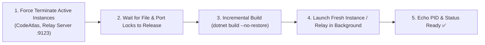

# Feature Specification: Developer Inner-Loop & Clean Teardown Utility (`dev-restart`)

## 1. Overview & Objective

Provide a fast inner-loop cycle script (`scripts/dev-restart.ps1`) for active dogfooding and development. When developing CodeAtlas while simultaneously using it in an IDE or AI agent harness, running instances lock `bin/` DLLs and SQLite database files, causing `dotnet build` to fail with `MSB3027: The process cannot access the file because it is being used by another process`.

This utility terminates running instances, frees all file locks, recompiles the solution, and launches fresh background instances in a single fast command.

---

## 2. Dev Cycle Workflow



---

## 3. Script Specification (`scripts/dev-restart.ps1`)

```powershell
[CmdletBinding()]
param(
    [switch]$NoBuild,
    [int]$RelayPort = 9123
)

Write-Host "🛑 [1/4] Stopping active CodeAtlas and Relay processes..." -ForegroundColor Yellow

# Kill running CodeGraph processes
Get-Process -Name "CodeAtlas", "CodeAtlas.Cli" -ErrorAction SilentlyContinue | Stop-Process -Force

# Kill process listening on Relay port
$portConnection = Get-NetTCPConnection -LocalPort $RelayPort -ErrorAction SilentlyContinue
if ($portConnection) {
    Stop-Process -Id $portConnection.OwningProcess -Force -ErrorAction SilentlyContinue
}

Start-Sleep -Milliseconds 300

if (-not $NoBuild) {
    Write-Host "🔨 [2/4] Rebuilding solution..." -ForegroundColor Cyan
    dotnet build (Join-Path $PSScriptRoot "..\CodeAtlas.slnx") -c Debug --no-restore
    if ($LASTEXITCODE -ne 0) {
        Write-Error "Build failed! Aborting restart."
        exit $LASTEXITCODE
    }
}

Write-Host "🚀 [3/4] Launching fresh instance..." -ForegroundColor Green
$binPath = Join-Path $PSScriptRoot "..\src\CodeAtlas\bin\Debug\net8.0\CodeAtlas.exe"
if (Test-Path $binPath) {
    Start-Process -FilePath $binPath -ArgumentList "serve" -WindowStyle Hidden
    Write-Host "✅ [4/4] CodeAtlas running fresh!" -ForegroundColor Green
} else {
    Write-Host "⚠️ Binary not found at $binPath, check build output." -ForegroundColor Red
}
```

---

## 4. Key Benefits
- **Zero Lock Collisions**: Guarantees `dotnet build` will never hit `MSB3027` file-in-use errors during dogfooding.
- **Sub-Second Feedback**: Rebuilds and relaunches with a single command or IDE keybinding.
- **Port Sanitation**: Ensures port `9123` is always cleanly freed before starting the relay daemon.
