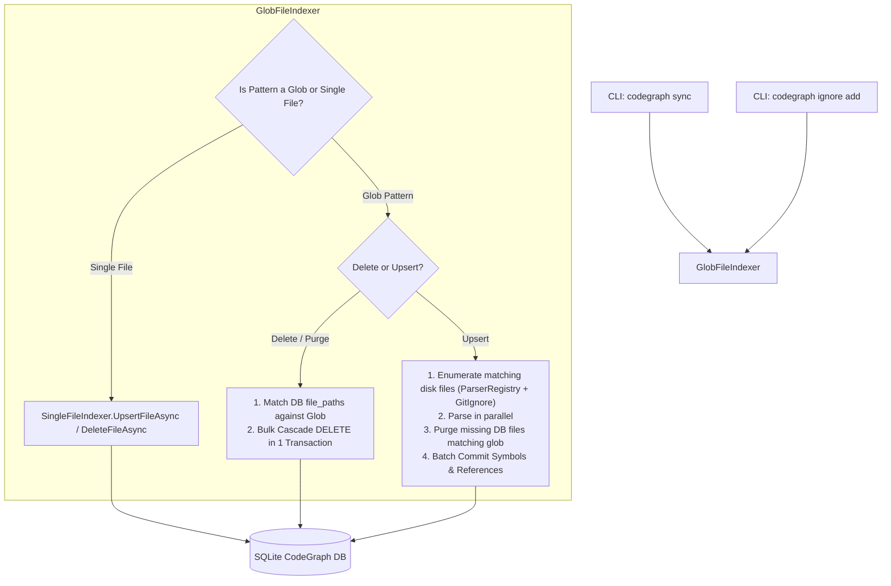

# Feature Specification & Plan: Glob-Based Batch Re-Indexing & Ignore Purge

**Plan Version:** 1.0 (Model Tag: `g37`)  
**Status:** Proposed / Ready for Review  
**Target Projects:** `CodeAtlas.Core`, `CodeAtlas.Cli`, `CodeAtlas.Mcp`, `CodeAtlas.Tests`

---

## 1. Executive Summary & Objective

Extend the existing single-file indexing capability (`SingleFileIndexer` / `codegraph sync-file`) into a high-performance **Glob & Batch Synchronization Engine** (`GlobFileIndexer` / `codegraph sync`), enabling:
1. **Targeted Subsystem Upserts**: Index or update all files matching a glob pattern (e.g. `src/Services/**/*.cs`) in parallel and commit in batched SQLite transactions.
2. **Bulk Graph Purges**: Cascade-delete symbols, references, and cross-stack mappings for any files in the index matching a glob pattern (e.g. `codegraph sync "src/Legacy/**" --delete` or `codegraph prune --glob "..."`).
3. **Automatic Purge on Ignore**: Allow `codegraph ignore add <pattern> --purge` to immediately scrub matching records from the SQLite database.
4. **Deleted File Reconciliation**: When syncing a glob, automatically detect and purge files that exist in the index database matching the glob but no longer exist on disk.

---

## 2. CLI Command Suite Specification

### 2.1. Unified `codegraph sync` (with `sync-file` as alias)

* **Syntax**: `codegraph sync <path-or-glob> [--repo|-r <path>] [--db-dir <path>] [--delete|-d] [--no-ignore] [--verbose|-v]`
* **Arguments**:
  * `path-or-glob` (Required, `string`): An exact relative/absolute file path (e.g. `src/MyClass.cs`) OR a glob expression (e.g. `src/Services/**/*.cs`, `tests/fixtures/**`, `*.generated.ts`).
* **Options**:
  * `--repo` / `-r` (Optional, `DirectoryInfo?`): Target repository path (defaults to auto-detected git root or current working directory).
  * `--db-dir` (Optional, `DirectoryInfo?`): SQLite database directory override.
  * `--delete` / `-d` (Optional, `bool`): Delete/purge matched files and their symbols from the index rather than upserting.
  * `--no-ignore` (Optional, `bool`): Bypass `.gitignore` and `settings.json` ignore rules during disk enumeration.
  * `--verbose` / `-v` (Optional, `bool`): Detailed logging of individual file operations.

### 2.2. Enhanced `codegraph ignore add` with `--purge` flag

* **Syntax**: `codegraph ignore add <pattern> [--repo|-r <path>] [--purge|-p]`
* **Behavior**:
  1. Writes the normalized pattern to `.codeatlas/settings.json` via `ProjectConfigManager.AddIgnorePattern`.
  2. If `--purge` is set and an index database exists:
     - Identifies all `file_path`s in `symbols` matching the pattern.
     - Cascade deletes all matching symbols, references, and cross-stack mappings in a single transaction.
     - Emits: `Added ignore pattern '<pattern>' and purged X symbols and Y references from index.`

---

## 3. Architecture & Execution Flow



---

## 4. Core Components & Implementation Details

### 4.1. `GlobFileIndexer` (`src/CodeAtlas.Core/Indexer/GlobFileIndexer.cs`)

```csharp
namespace CodeAtlas.Core.Indexer;

public sealed record GlobSyncResult(
    string Pattern,
    int FilesProcessed,
    int FilesDeleted,
    int SymbolsAdded,
    int SymbolsUpdated,
    int SymbolsDeleted,
    int ReferencesUpdated,
    int ReferencesDeleted,
    long ElapsedMs,
    string? Message = null);

public interface IGlobFileIndexer
{
    Task<GlobSyncResult> SyncGlobAsync(
        string workspaceRoot,
        CodeAtlasDb db,
        string pathOrGlob,
        bool isDelete = false,
        bool noIgnore = false,
        bool verbose = false,
        CancellationToken ct = default);

    Task<GlobSyncResult> PurgeGlobAsync(
        string workspaceRoot,
        CodeAtlasDb db,
        string globPattern,
        CancellationToken ct = default);
}
```

#### Key Implementation Details:
1. **Glob Detection**:
   ```csharp
   public static bool IsGlobPattern(string input) =>
       input.Contains('*') || input.Contains('?') || input.Contains('[');
   ```
2. **Purge Optimization (Bulk Deletion)**:
   - Fetches distinct indexed `file_path`s from `symbols`.
   - Uses `GitIgnoreMatcher.IgnoreRule.Parse(normGlob, "")` to filter matching files in memory.
   - Executes parameterized chunked `IN (...)` deletions or temporary table joins for fast indexed cleanup within a single transaction.
3. **Upsert Optimization (Parallel Parsing + Chunked Commit)**:
   - Uses `IndexOrchestrator` / `SolutionRootResolver` enumeration filtered by the glob rule.
   - Parses ASTs across thread pool (`Parallel.ForEach` / `Task.WhenAll`).
   - Batches symbol and reference insertions inside unified SQLite transactions (e.g. 100 files per transaction).

### 4.2. MCP Tool Integration (`src/CodeAtlas.Mcp/Mcp/Tools/SyncFileTool.cs`)

Enhance `SyncFileTool.SyncFileAsync` to seamlessly handle both single files and glob patterns, or introduce `SyncGlobTool`:
* If `filePath` contains wildcards (`*`, `?`), delegate directly to `IGlobFileIndexer`.
* Buffer invalidation: invalidates all touched files in `IWorkspaceBufferManager`.

---

## 5. Testing & Verification Matrix

### 5.1. Unit Tests (`GlobFileIndexerTests.cs`)
1. **`SyncGlob_UpsertsMatchingFiles`**:
   - Creates directory structure with multiple `.cs` files across nested folders.
   - Syncs `"src/**/*.cs"`.
   - Asserts all matching files and symbols are indexed.
2. **`SyncGlob_DeletesMissingFiles`**:
   - Indexes 3 files matching `src/Features/*.cs`.
   - Deletes 1 file from disk.
   - Re-runs `SyncGlob("src/Features/*.cs")`.
   - Asserts the deleted file's symbols and references are purged from the DB.
3. **`PurgeGlob_RemovesMatchingSymbolsAndReferences`**:
   - Indexes multiple files.
   - Invokes `PurgeGlobAsync("tests/fixtures/**")`.
   - Asserts only fixture symbols/references are deleted while others remain intact.

### 5.2. CLI End-to-End Tests (`SyncCliTests.cs` / `IgnoreCommandTests.cs`)
1. **`SyncCommand_WithGlob_IndexesMatchingFiles`**:
   - CLI invocation: `codegraph sync "src/**/*.cs" -r <tempDir>`.
   - Asserts exit code `0` and proper output summary.
2. **`SyncCommand_WithDeleteFlag_PurgesMatchingFiles`**:
   - CLI invocation: `codegraph sync "tests/**" -r <tempDir> --delete`.
   - Asserts matching records removed from DB.
3. **`IgnoreAdd_WithPurgeFlag_UpdatesSettingsAndPurgesDb`**:
   - Pre-populates DB with fixture symbols.
   - CLI invocation: `codegraph ignore add "tests/fixtures/**" -r <tempDir> --purge`.
   - Asserts `.codeatlas/settings.json` is updated and DB records for `tests/fixtures/**` are purged.

---

## 6. Implementation Checklist

- [x] **Phase 1: Core Glob Indexing Service**
  - Implement `GlobFileIndexer` in `CodeAtlas.Core/Indexer/GlobFileIndexer.cs`.
  - Register in DI / Core factories.
  - Add unit tests in `GlobFileIndexerTests.cs`.
- [x] **Phase 2: CLI Wiring & Ignore Purge Integration**
  - Update `CommandFactory.cs` to add `sync` command (aliasing `sync-file`).
  - Update `IgnoreCommandHandler.cs` to support `--purge` / `-p`.
  - Add CLI integration tests in `SyncCliTests.cs`.
- [x] **Phase 3: MCP Server Tool Support**
  - Update `SyncFileTool.cs` to handle globs.
  - Verify MCP protocol contracts.
- [x] **Phase 4: Verification & Performance Validation**
  - Run full test suite (`dotnet test`).
  - Validate against sample multi-file repository.
