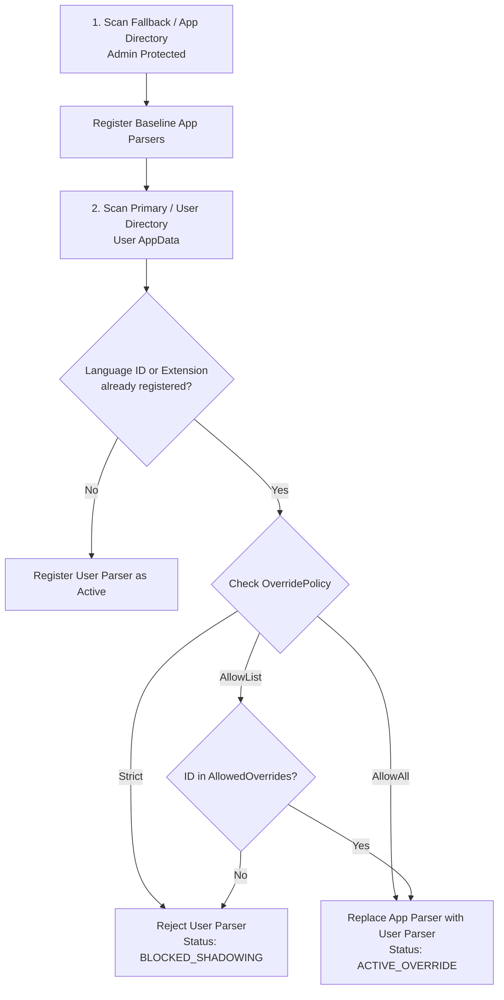

# Architectural Plan: Modular / Drop-in Parsers for CodeAtlas

**Model Tag**: `g37` (Gemini 3.7 Flash)  
**Target Path**: `D:\Projects\C#\CodeAtlas\plan\moduler-dropin-parsers.plan.g37.md`  
**Status**: Proposal / Architectural Plan  
**Target Architecture**: Decoupled, folder-isolated drop-in parser plugins with multi-tier directory resolution, runtime `AssemblyLoadContext` isolation, anti-shadowing security policies, and CLI lifecycle management.

---

## 🎯 1. Overview & Architectural Motivation

Currently, `CodeAtlas` embeds all language parsers (C#, TypeScript, JavaScript, HTML, PowerShell, JSON, YAML, CSS) directly inside the `CodeAtlas.Core` class library. While straightforward for initial development, this tight coupling presents several long-term limitations:

1. **Monolithic Dependency Footprint**: Core references all AST dependencies (Roslyn, TreeSitter runtimes, etc.) regardless of whether a user or repository needs them.
2. **Zero Third-Party Extensibility**: Adding support for a new language (e.g., Python, Go, Rust, Kotlin, SQL) requires modifying `CodeAtlas.Core` source code and recompiling the entire solution.
3. **No Dynamic Parser Lifecycle**: Users cannot disable unneeded parsers, test experimental parser builds, or swap out parsing implementations without modifying code.
4. **Binary Shadowing & Security Risks**: If arbitrary drop-in assemblies are discovered from unprivileged locations (like `%LOCALAPPDATA%`), malicious scripts or dependencies could hijack indexing logic unless guarded by strict security policies.

### Core Objectives
* **Isolated Parser Assemblies**: Each parser lives in its own standalone `.csproj` and compiles into a dedicated subfolder containing its primary DLL and dependencies.
* **Dual-Folder Non-Destructive Management**: Enable/disable parsers by moving folders between `Parsers/` (active) and `DisabledParsers/` (inactive).
* **Multi-Tier Directory Resolution**: Support user profile storage (`%LOCALAPPDATA%`), portable app-relative storage (`<AppBaseDir>`), and environment variable overrides (`CODEATLAS_PARSERS_DIR`).
* **Anti-Hijacking Security Policy**: Configurable override policy (`Strict`, `AllowAll`, `AllowList`) preventing unprivileged user folders from shadowing secure system/app binaries.
* **Runtime Isolation via `AssemblyLoadContext`**: Dedicated ALC per parser folder to prevent assembly locking and dependency version collisions.
* **CLI Lifecycle Management**: Subcommands in `CodeAtlas.Cli` (`codegraph parsers list`, `enable`, `disable`, `info`).

---

## 🏗️ 2. Proposed Architecture & Folder Topology

### Solution Layout
```
CodeAtlas.slnx
├── src/
│   ├── CodeAtlas.Core/             # Shared contracts & indexing engine
│   │   ├── Parser/                    # ILanguageParser, ParserMetadata, IParserRegistry
│   │   ├── Plugins/                   # AssemblyLoadContext, Discovery & Security Resolution
│   │   └── Indexer/                   # IndexOrchestrator consuming IParserRegistry
│   │
│   ├── CodeAtlas.Mcp/           # MCP stdio host daemon
│   │   └── Mcp/Tools/                 # GetSupportedLanguagesTool dynamically querying registry
│   │
│   ├── CodeAtlas.Cli/              # CLI executable
│   │   └── Commands/Parsers/          # 'parsers list', 'enable', 'disable', 'info'
│   │
│   └── Parsers/                       # Standalone drop-in parser projects
│       ├── Directory.Build.props      # Shared build properties & Core reference
│       ├── Directory.Build.targets    # Auto-copy output to dev Parsers/ folder
│       ├── CodeAtlas.Parsers.CSharp/
│       ├── CodeAtlas.Parsers.TypeScript/
│       ├── CodeAtlas.Parsers.JavaScript/
│       ├── CodeAtlas.Parsers.Html/
│       ├── CodeAtlas.Parsers.PowerShell/
│       ├── CodeAtlas.Parsers.Json/
│       ├── CodeAtlas.Parsers.Yaml/
│       └── CodeAtlas.Parsers.Css/
│
└── tests/
    └── CodeAtlas.Tests/            # Unit & integration tests for ALC loader & security
```

### Runtime Directory Hierarchy
```
<Storage Root>/
├── Parsers/                           # ACTIVE: Parsers loaded at startup
│   ├── CSharp/
│   │   ├── CodeAtlas.Parsers.CSharp.dll
│   │   ├── Microsoft.CodeAnalysis.CSharp.dll
│   │   └── parser.json (optional metadata)
│   ├── TypeScript/
│   │   ├── CodeAtlas.Parsers.TypeScript.dll
│   │   └── TreeSitter.Bindings.dll
│   └── ...
│
└── DisabledParsers/                   # INACTIVE: Ignored by runtime indexer
    └── Python/
        └── CodeAtlas.Parsers.Python.dll
```

---

## 🔒 3. Multi-Tier Resolution & Security Override Policy

### Tiered Discovery Hierarchy
When the host application initializes, it scans directories in the following priority order:

| Tier | Source | Default Windows Path | Default Linux/macOS Path | Access Level |
| :--- | :--- | :--- | :--- | :--- |
| **Tier 1 (Override)** | Environment Var | `$env:CODEATLAS_PARSERS_DIR` | `$CODEATLAS_PARSERS_DIR` | Custom / CI-CD |
| **Tier 2 (Primary)** | User Data | `%LOCALAPPDATA%\CodeAtlas\Parsers` | `~/.local/share/codegraph/parsers` | Unprivileged / Per-User |
| **Tier 3 (Fallback)** | App Base Directory | `<AppBaseDir>\Parsers` | `<AppBaseDir>/parsers` | Admin / System / Portable |

### Security & Anti-Shadowing Policy
To protect against malicious code injection (where an untrusted process writes a fake parser into `%LOCALAPPDATA%` to hijack indexing), the parser discovery engine enforces configurable override policies:

```json
{
  "ParserSecurity": {
    "OverridePolicy": "Strict",
    "AllowedOverrides": [
      "csharp",
      "custom-dsl"
    ],
    "WarnOnShadowAttempt": true
  }
}
```

#### Policy Definitions:
1. **`Strict` (Default / Production Mode)**:
   - System/App directory parsers take precedence and **cannot** be shadowed or overridden by user-level parsers.
   - If a parser in `%LOCALAPPDATA%` claims the same Language ID or handled file extensions as an App-level parser, it is **blocked** and logged.
2. **`AllowAll` (Developer Mode)**:
   - User-level parsers take precedence over App-level parsers. Useful for testing new parser versions locally without modifying protected directories.
3. **`AllowList` (Selective Override)**:
   - Only parser IDs explicitly declared in `AllowedOverrides` can be shadowed by user-level versions.



---

## 🧩 4. Core Abstractions & Plugin Loader Specification

### 4.1 Parser Contract (`CodeAtlas.Core`)
```csharp
namespace CodeAtlas.Parser;

public interface ILanguageParser
{
    ParserMetadata Metadata { get; }
    IReadOnlyList<string> FileExtensions { get; }
    string Language { get; }

    IEnumerable<Symbol> Parse(string filePath, string source);
    IEnumerable<SymbolReference> ParseReferences(string filePath, string source) => [];
    
    FileParseResult ParseFile(string filePath, string source) =>
        new(Parse(filePath, source).ToList(), ParseReferences(filePath, source).ToList());
}

public sealed record ParserMetadata(
    string Id,
    string Name,
    string Version,
    string? Description = null,
    string? Author = null);
```

### 4.2 AssemblyLoadContext Isolation (`ParserLoadContext`)
Each parser folder is loaded inside its own collectible `AssemblyLoadContext` with an `AssemblyDependencyResolver` to ensure isolated resolution of native dependencies and transitive assemblies:

```csharp
namespace CodeAtlas.Core.Plugins;

public sealed class ParserLoadContext : AssemblyLoadContext
{
    private readonly AssemblyDependencyResolver _resolver;

    public ParserLoadContext(string pluginMainAssemblyPath) 
        : base(name: Path.GetFileNameWithoutExtension(pluginMainAssemblyPath), isCollectible: true)
    {
        _resolver = new AssemblyDependencyResolver(pluginMainAssemblyPath);
    }

    protected override Assembly? Load(AssemblyName assemblyName)
    {
        // Share Core abstractions with host
        if (assemblyName.Name == "CodeAtlas.Core")
            return null;

        string? assemblyPath = _resolver.ResolveAssemblyToPath(assemblyName);
        return assemblyPath != null ? LoadFromAssemblyPath(assemblyPath) : null;
    }

    protected override IntPtr LoadUnmanagedDll(string unmanagedDllName)
    {
        string? libraryPath = _resolver.ResolveUnmanagedDllToPath(unmanagedDllName);
        return libraryPath != null ? LoadUnmanagedDllFromPath(libraryPath) : IntPtr.Zero;
    }
}
```

---

## 💻 5. CLI Interface & Management Commands

The CLI will expose intuitive commands to inspect, enable, and disable parsers non-destructively:

### Command Matrix
| Command | Description | Behavior |
| :--- | :--- | :--- |
| `codegraph parsers list` | List all discovered parsers | Displays table with ID, language, source tier, status, and handled extensions |
| `codegraph parsers enable <id>` | Enable a disabled parser | Moves `<id>/` directory from `DisabledParsers/` to `Parsers/` |
| `codegraph parsers disable <id>` | Disable an active parser | Moves `<id>/` directory from `Parsers/` to `DisabledParsers/` |
| `codegraph parsers info <id>` | Inspect detailed metadata | Shows version, author, dependencies, assembly path, and security status |

### Example CLI Output (`codegraph parsers list`)
```text
Discovered Language Parsers:

STATUS               ID           LANGUAGE     VERSION  EXTENSIONS            SOURCE   PATH
----------------------------------------------------------------------------------------------------------------------
[ACTIVE]             csharp       csharp       1.0.0    .cs                   [App]    C:\Program Files\CodeAtlas\Parsers\CSharp
[ACTIVE (OVERRIDE)]  typescript   typescript   2.1.0    .ts,.tsx,.cts,.mts    [User]   %LOCALAPPDATA%\CodeAtlas\Parsers\TypeScript
[BLOCKED (SHADOW)]   python       python       0.9.0    .py                   [User]   %LOCALAPPDATA%\CodeAtlas\Parsers\Python
  └─ Reason: Shadowing blocked by 'Strict' security policy (App parser takes precedence)
[DISABLED]           rust         rust         0.5.0    .rs                   [App]    C:\Program Files\CodeAtlas\DisabledParsers\Rust
```

---

## 📦 6. Developer Experience & Zero-Boilerplate Build Setup

To eliminate boilerplate across multiple parser projects, MSBuild properties are centralized in `src/Parsers/`:

### `src/Parsers/Directory.Build.props`
```xml
<Project>
  <PropertyGroup>
    <TargetFramework>net10.0</TargetFramework>
    <ImplicitUsings>enable</ImplicitUsings>
    <Nullable>enable</Nullable>
    <EnableDynamicLoading>true</EnableDynamicLoading>
  </PropertyGroup>

  <ItemGroup>
    <ProjectReference Include="..\CodeAtlas.Core\CodeAtlas.Core.csproj" Private="false" ExcludeAssets="runtime" />
  </ItemGroup>
</Project>
```

### `src/Parsers/Directory.Build.targets`
```xml
<Project>
  <Target Name="CopyToDevParsersFolder" AfterTargets="Build">
    <PropertyGroup>
      <ParserFolderTargetName>$(MSBuildProjectName.Replace('CodeAtlas.Parsers.', ''))</ParserFolderTargetName>
      <TargetParserDir>$(SolutionDir)src\CodeAtlas.Cli\bin\$(Configuration)\net10.0\Parsers\$(ParserFolderTargetName)\</TargetParserDir>
    </PropertyGroup>
    <ItemGroup>
      <ParserOutputFiles Include="$(TargetDir)**\*.*" />
    </ItemGroup>
    <Copy SourceFiles="@(ParserOutputFiles)"
          DestinationFiles="@(ParserOutputFiles->'$(TargetParserDir)%(RecursiveDir)%(Filename)%(Extension)')"
          SkipUnchangedFiles="true" />
  </Target>
</Project>
```

---

## 🚀 7. Multi-Stage Implementation Plan

### Stage 1: Core Contracts & Parser Registry Refactor (`CodeAtlas.Core`) [COMPLETED]
- [x] Add `ParserMetadata` model and update `ILanguageParser` with metadata properties.
- [x] Create `IParserRegistry` interface and `ParserRegistry` implementation.
- [x] Implement `ParserDirectoryResolver` supporting Environment, User AppData, and AppBaseDir fallback paths.
- [x] Implement `ParserSecurityPolicy` with `Strict`, `AllowAll`, and `AllowList` evaluation modes.
- [x] Refactor `IndexOrchestrator`, `DeltaEngine`, `DirtyFileBuffer`, and `WorkspaceBufferManager` to consume `IParserRegistry` instead of hardcoded parser lists.

### Stage 2: Dynamic Plugin Discovery & `AssemblyLoadContext` Engine (`CodeAtlas.Core`) [COMPLETED]
- [x] Implement `ParserLoadContext` inheriting from `AssemblyLoadContext`.
- [x] Build `DirectoryParserPluginLoader` scanning `Parsers/` folders, inspecting assemblies for `ILanguageParser` implementations, and instantiating them safely.
- [x] Implement collision detection and security shadow-blocking diagnostics.

### Stage 3: Parser Migration into Isolated Projects (`src/Parsers/`) [COMPLETED]
- [x] Create `src/Parsers/Directory.Build.props` and `Directory.Build.targets`.
- [x] Extract existing parsers into dedicated `.csproj` projects:
  - `src/Parsers/CodeAtlas.Parsers.CSharp`
  - `src/Parsers/CodeAtlas.Parsers.TypeScript`
  - `src/Parsers/CodeAtlas.Parsers.JavaScript`
  - `src/Parsers/CodeAtlas.Parsers.Html`
  - `src/Parsers/CodeAtlas.Parsers.PowerShell`
  - `src/Parsers/CodeAtlas.Parsers.Json`
  - `src/Parsers/CodeAtlas.Parsers.Yaml`
  - `src/Parsers/CodeAtlas.Parsers.Css`
- [x] Add all parser projects to `CodeAtlas.slnx`.

### Stage 4: CLI Management Commands (`CodeAtlas.Cli`) [COMPLETED]
- [x] Implement `ParsersCommand` in `CodeAtlas.Cli.Commands`.
- [x] Implement `parsers list` table formatter with status tags (`ACTIVE`, `OVERRIDE`, `BLOCKED`, `DISABLED`).
- [x] Implement `parsers enable <id>` and `parsers disable <id>` folder move operations with error handling for locked files.
- [x] Implement `parsers info <id>` metadata viewer.

### Stage 5: MCP Daemon Integration (`CodeAtlas.Mcp`) [COMPLETED]
- [x] Wire `IParserRegistry` into `CodeAtlas.Mcp` dependency container.
- [x] Update `GetSupportedLanguagesTool` to return dynamically loaded parsers.
- [x] Ensure MCP indexing requests seamlessly utilize active registry parsers.

### Stage 6: Testing, Security Auditing & Verification [COMPLETED]
- [x] **Unit Tests**:
  - `ParserDirectoryResolverTests`: Verify priority order (Env -> User -> App).
  - `ParserSecurityPolicyTests`: Test `Strict` rejection of shadowed binaries vs. `AllowAll` override mode.
  - `FolderLifecycleTests`: Test atomic move between `Parsers/` and `DisabledParsers/`.
- [x] **Integration Tests**:
  - `DynamicParserLoadingTests`: Load test assembly via ALC, parse test code, and verify symbol extraction.
  - `UnloadTests`: Verify ALC unloads cleanly without locking files on disk.
- [x] **End-to-End Tests**:
  - Execute `dotnet build` -> verify all parsers deployed to `Parsers/`.
  - Execute `codegraph parsers list`, `disable`, `enable`, and run full indexing pass on sample multi-language repositories.

---

## ⚠️ 8. Risks & Mitigations

| Risk | Impact | Mitigation Strategy |
| :--- | :--- | :--- |
| **Native DLL / Unmanaged Dependency Resolution** | Tree-sitter C runtime fails to load across platforms | Override `ResolveUnmanagedDllToPath()` in `ParserLoadContext` and ensure native `.dll`/`.so`/`.dylib` are packaged in parser output subdirectories. |
| **File Locking During Enable/Disable** | `IOException` when attempting `Directory.Move` while app or file watcher is active | CLI management commands run standalone; if in-process, ALC is cleanly unloaded and garbage-collected before directory operations. |
| **Permission Denied on System Directory** | Modifying `C:\Program Files` without Administrator privileges | CLI commands verify write permissions upfront. If system directory is write-protected, CLI prompts user or directs modifications to `%LOCALAPPDATA%`. |
| **DLL Hijacking / Malicious Shadowing** | Rogue code execution in user-space during background indexing | Default to `Strict` override policy; app-level binaries are immutable and take absolute precedence over unprivileged user-level binaries unless explicitly opted in. |
