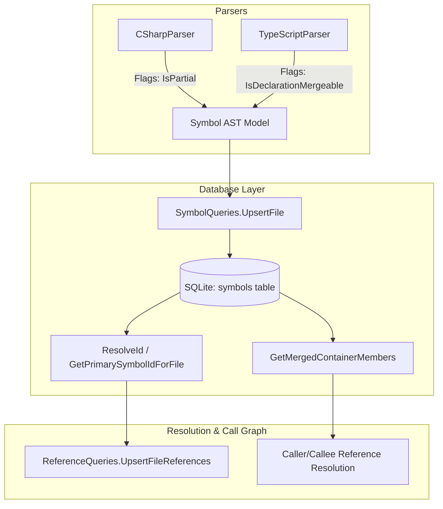

# Dedicated Implementation Plan: Multi-File Symbol Declaration Merging

This plan specifically details the architecture, data models, parser changes, database queries, and verification strategy for handling **multi-file symbol declarations** (such as C# `partial` classes/interfaces/structs/records and TypeScript/JavaScript `interface`/`namespace` declaration merging).

---

## Problem & Objectives

### Background & Problem Statement
In modern language runtimes:
- **C#**: A single class/struct/interface can be split across multiple files using the `partial` keyword (e.g., `UserService.cs` and `UserService.Designer.cs`). Members declared in `UserService.Designer.cs` belong to the same type defined in `UserService.cs`.
- **TypeScript / JavaScript**: Declarations with the same identifier (e.g. `interface UserConfig`, `namespace App`) automatically merge across files or modules.

Currently, indexers treat each file's symbol declarations independently or overwrite/shadow symbols with identical names. When resolving caller/callee references or querying a type's methods, references pointing to a member declared in File B (e.g. `PartialClass.HelperMethod`) fail to link to the primary type container declared in File A.

### Objectives
1. **Language-Agnostic Trait Extraction**: Capture `IsPartial` / `IsDeclarationMergeable` flags during language AST parsing.
2. **Unified Scope & Container Merging**: Ensure `SymbolQueries` and symbol lookups aggregate members across all files declaring parts of the target container.
3. **Multi-Location Reference Linking**: Ensure reference resolution (`ResolveId`, `FindCallers`, `FindCallees`) accurately connects callers/callees regardless of which partial file site holds the specific member or container declaration.

---

## Technical Architecture & Detailed Design



### 1. Data Model Enhancements

#### `Symbol.cs`
Add metadata traits to the `Symbol` record to indicate if a container is partial/mergeable:

```csharp
public sealed record Symbol
{
    // ... Existing fields ...
    public bool IsPartial { get; init; } // True for C# partial or TS merged declarations
}
```

#### Database Schema Migration (`MigrationRunner.cs`)
Add an optional column or JSON metadata column to `symbols` table if persistence of traits is required:
```sql
ALTER TABLE symbols ADD COLUMN is_partial INTEGER NOT NULL DEFAULT 0;
```

---

### 2. Parser Implementations

#### C# (`CSharpParser.cs`)
- Inspect AST syntax nodes for `ClassDeclarationSyntax`, `StructDeclarationSyntax`, `InterfaceDeclarationSyntax`, and `RecordDeclarationSyntax`.
- Check if `modifiers` contain `SyntaxKind.PartialKeyword`.
- Set `IsPartial = true` on the container symbol.

#### TypeScript / JavaScript (`TypeScriptParser.cs`)
- Inspect AST nodes for `InterfaceDeclaration`, `ModuleDeclaration` (namespaces), or augmented module declarations.
- Mark container symbols as `IsPartial = true` / mergeable when encountering interface or namespace declarations that match standard merging patterns.

---

### 3. Database & Query Layer (`SymbolQueries.cs`)

#### Multi-Location Symbol ID Resolution
Update `ResolveId` to handle partial declaration scopes:
- When resolving a container (e.g., `MyNamespace.UserService`), return the primary/first-registered declaration ID, while storing cross-file mappings.
- When resolving a member function (e.g., `HelperMethod`), match against parent `ClassName` regardless of which partial file path contains the method.

#### Query Additions in `SymbolQueries.cs`
- `GetDeclarationsForSymbol(string symbolName, string? namespaceName)`: Returns all file paths and line ranges where a merged type is declared.
- `GetMembersForMergedType(string className, string? namespaceName)`: Returns all members (methods, properties) aggregated across all partial files matching the type name.

---

## Proposed Changes & File Checklist

### Data Models & DB
- 📄 [MODIFY] [Symbol.cs](file:///d:/Projects/C%23/CodeAtlas/src/CodeAtlas/Models/Symbol.cs)
  - Add `IsPartial` boolean property.
- 📄 [MODIFY] [MigrationRunner.cs](file:///d:/Projects/C%23/CodeAtlas/src/CodeAtlas/Db/MigrationRunner.cs)
  - Add SQLite migration step for `is_partial` column in `symbols` table.

### Parsers
- 📄 [MODIFY] [CSharpParser.cs](file:///d:/Projects/C%23/CodeAtlas/src/CodeAtlas/Parser/CSharpParser.cs)
  - Detect `partial` modifier on class, struct, interface, and record syntax nodes.
- 📄 [MODIFY] [TypeScriptParser.cs](file:///d:/Projects/C%23/CodeAtlas/src/CodeAtlas/Parser/TypeScriptParser.cs)
  - Detect merged `interface` and `namespace` AST nodes.

### DB Queries & Indexer
- 📄 [MODIFY] [SymbolQueries.cs](file:///d:/Projects/C%23/CodeAtlas/src/CodeAtlas/Db/Queries/SymbolQueries.cs)
  - Update `UpsertFile` to write `is_partial`.
  - Update `ResolveId` and `FindByName` to return aggregated member definitions across partial file declarations.
- 📄 [MODIFY] [ReferenceQueries.cs](file:///d:/Projects/C%23/CodeAtlas/src/CodeAtlas/Db/Queries/ReferenceQueries.cs)
  - Ensure cross-file caller lookups resolve methods contained within partial classes declared across multiple files.

---

## Verification & Test Plan

### Automated Unit & Integration Tests (`tests/CodeAtlas.Tests/`)
1. **C# Partial Class Test**:
   - Create mock files `User.cs` (declaring `partial class User { void MethodA(); }`) and `User.Extended.cs` (declaring `partial class User { void MethodB(); }`).
   - Run `CSharpParser` on both files and verify both set `IsPartial = true`.
   - Index both files into `SymbolQueries` and verify `FindByName("User")` returns all declaration locations.
   - Verify `GetMembersForMergedType("User")` yields both `MethodA` and `MethodB`.

2. **TypeScript Declaration Merging Test**:
   - Create mock files `config1.ts` (`interface Config { host: string; }`) and `config2.ts` (`interface Config { port: number; }`).
   - Verify `TypeScriptParser` marks `Config` interfaces as mergeable and `SymbolQueries` resolves both fields under the unified `Config` scope.

3. **Call Graph Cross-File Reference Test**:
   - Call `MethodB()` from a third file `Program.cs`.
   - Verify `ReferenceQueries.FindCallers("MethodB")` and `FindCallees("Main")` correctly link across `Program.cs` and `User.Extended.cs` back to the parent `User` type.

### Manual Verification
- Execute `dotnet test` to pass all solution test suites.
