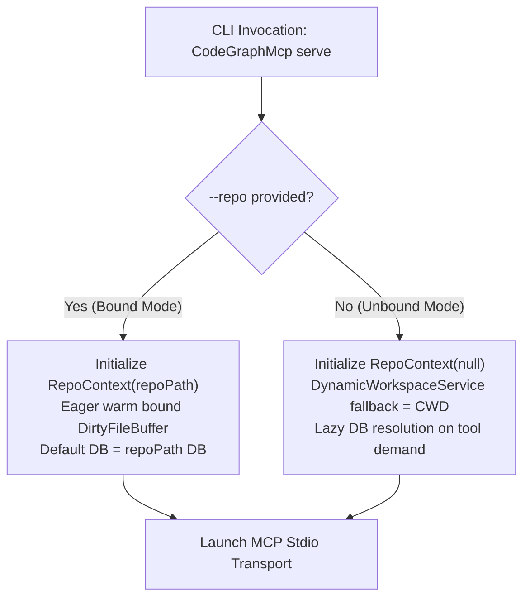

# Phase 6: Unbound CLI Entry Point Implementation Plan

## Architectural Overview & Objective

The **Unbound CLI Entry Point** feature enables `CodeGraphMcp` to launch in "unbound mode" where a fixed target repository is not specified upfront via the command line. Instead of requiring `--repo <path>`, `CodeGraphMcp serve` can be executed standalone. The server dynamically resolves, auto-indexes, and queries code graphs on demand based on the `target_directory` parameter passed in individual MCP tool calls.

This plan details the changes needed in `CommandFactory.cs`, `McpServer.cs`, and associated dependency injection setups to support optional repository binding cleanly and robustly.

---

## Strategic Component Overview



---

## Detailed File Changes

### 1. Command Definition (`CommandFactory.cs`)
#### [MODIFY] [CommandFactory.cs](file:///d:/Projects/C%23/CodeGraphMcp/src/CodeGraphMcp/Commands/CommandFactory.cs)
- **Make `--repo` Option Explicitly Optional**: Update option help text and default resolution for `serveCommand`.
- **Argument & Option Behavior**:
  - `serveRepoOption`: `new Option<DirectoryInfo?>(new[] { "--repo", "-r" }, "Repository path to serve (optional, defaults to unbound dynamic mode)")`.
  - `serveDbDirOption`: `--db-dir` (optional override for database storage location).
  - `serveStoreLocalOption`: `-l` / `--store-local` (requires `--repo` or defaults to active workspace directory).
- **Handler Mapping**:
  ```csharp
  serveCommand.SetHandler(async (repo, dbDir, storeLocal) =>
  {
      var repoPath = repo?.FullName;
      var dbPath = repoPath is not null 
          ? StorageConfig.ResolveDbPath(dbDir?.FullName, storeLocal, repoPath) 
          : dbDir?.FullName;
      await McpServer.RunAsync(repoPath, dbPath);
  }, serveRepoOption, serveDbDirOption, serveStoreLocalOption);
  ```

---

### 2. Dependency Injection & Server Startup (`McpServer.cs`)
#### [MODIFY] [McpServer.cs](file:///d:/Projects/C%23/CodeGraphMcp/src/CodeGraphMcp/Mcp/McpServer.cs)
- **Update `RepoContext`**: Allow `RepoPath` to be nullable (`string?`) to represent unbound server state.
  ```csharp
  public sealed record RepoContext(string? RepoPath);
  ```
- **Dynamic Service Registration**:
  - Register `RepoContext` with optional `repoPath`.
  - Register `IDynamicWorkspaceService` configured with `repoPath` fallback.
  - Update fallback resolution for `CodeGraphDb` and `DirtyFileBuffer` singletons:
    - If `repoPath` is specified (bound mode): eagerly resolve/warm `CodeGraphDb` and `DirtyFileBuffer` for `repoPath`.
    - If `repoPath` is null (unbound mode): initialize singletons using `Environment.CurrentDirectory` as baseline fallback, allowing per-tool overrides via `target_directory`.
- **Eager Buffer Warming Safety**:
  - Guard buffer warming:
    ```csharp
    if (!string.IsNullOrWhiteSpace(repoPath))
    {
        host.Services.GetRequiredService<DirtyFileBuffer>();
    }
    ```

---

## CLI Options & Execution Matrix

| Command Invocation | Server Mode | Default Workspace | Database Location |
| :--- | :--- | :--- | :--- |
| `CodeGraphMcp serve` | Unbound | Per tool call (fallback: CWD) | Standard AppData directory per workspace |
| `CodeGraphMcp serve --repo C:\MyProj` | Bound | `C:\MyProj` | Standard AppData directory for `C:\MyProj` |
| `CodeGraphMcp serve --repo C:\MyProj -l` | Bound | `C:\MyProj` | `C:\MyProj\.agent-index\codegraph.db` |
| `CodeGraphMcp serve --db-dir D:\DBs` | Unbound | Per tool call | Custom override directory `D:\DBs` |

---

## Verification & Testing Plan

### Automated Tests
1. **CLI Parser Tests**:
   - Verify `serve` command parses without flags and sets `repoPath = null`.
   - Verify `serve -r <path>` sets `repoPath` correctly.
2. **Server Bootstrap Tests**:
   - Test starting `McpServer.RunAsync(repoPath: null)` with immediate cancellation token to verify container building and singleton lifetime setup.
   - Test `RepoContext` nullability handling.

### Manual Verification
- **Unbound CLI Launch**: Run `dotnet run --project src/CodeGraphMcp -- serve` and verify JSON-RPC stdio server starts cleanly without errors.
- **Bound CLI Launch**: Run `dotnet run --project src/CodeGraphMcp -- serve -r .` and confirm bound startup behavior and buffer pre-warming.
