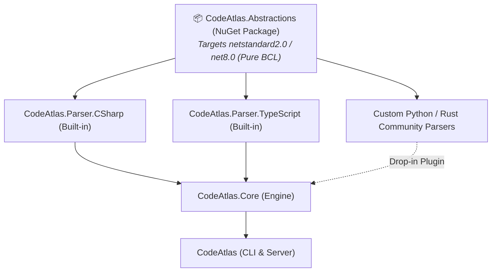

# Feature Specification: Plugin Abstractions & NuGet Packaging (`CodeAtlas.Abstractions`)

## 1. Overview & Objective

Extract core parser interfaces, data models, and contracts into a standalone, zero-dependency library project: **`CodeAtlas.Abstractions`**. 

This allows third-party developers, internal teams, and community contributors to build custom language parsers and indexers without referencing heavy internal engine dependencies (SQLite, LibGit2Sharp, Tree-Sitter native bindings, MCP transport layers). The abstractions library can then be built and published as a standalone NuGet package.

---

## 2. Solution Structure & Architecture



---

## 3. Types Relocated to `CodeAtlas.Abstractions`

| Type | Target Namespace | Purpose |
|---|---|---|
| **`ILanguageParser`** | `CodeAtlas.Abstractions` | Core parser interface (`Parse`, `ParseReferences`, `SupportedExtensions`, `LanguageId`). |
| **`Symbol`** | `CodeAtlas.Abstractions` | Immutable symbol definition record. |
| **`SymbolReference`** | `CodeAtlas.Abstractions` | Cross-file invocation/reference edge record. |
| **`SymbolType`** | `CodeAtlas.Abstractions` | Enum for symbol classifications (Class, Method, Property, Interface, etc.). |
| **`ParserMetadataAttribute`** | `CodeAtlas.Abstractions` | Declarative metadata attribute for automatic parser discovery. |

---

## 4. Project Configuration (`CodeAtlas.Abstractions.csproj`)

```xml
<Project Sdk="Microsoft.NET.Sdk">
  <PropertyGroup>
    <TargetFrameworks>net8.0;netstandard2.0</TargetFrameworks>
    <Nullable>enable</Nullable>
    <ImplicitUsings>enable</ImplicitUsings>
    
    <!-- NuGet Metadata -->
    <PackageId>CodeAtlas.Abstractions</PackageId>
    <Version>1.0.0</Version>
    <Authors>ScriptedFluff</Authors>
    <Description>Pure interfaces and contract models for extending the CodeAtlas indexing engine.</Description>
    <PackageLicenseExpression>MIT</PackageLicenseExpression>
    <RepositoryUrl>https://github.com/scriptedfluff/CodeAtlas</RepositoryUrl>
    <GeneratePackageOnBuild>true</GeneratePackageOnBuild>
  </PropertyGroup>
</Project>
```

---

## 5. Benefits
- **Zero-Dependency SDK**: Parser developers only need basic .NET types.
- **Contract Stability**: Isolates public plugin APIs from engine refactoring or database schema updates.
- **NuGet Distribution Ready**: Easily consumed by any .NET project via NuGet package manager.