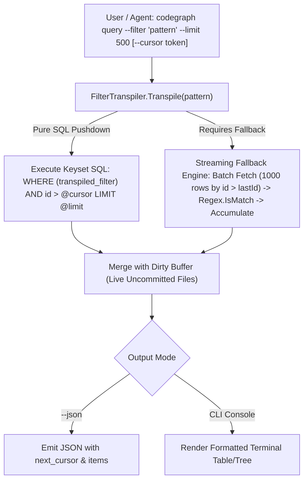
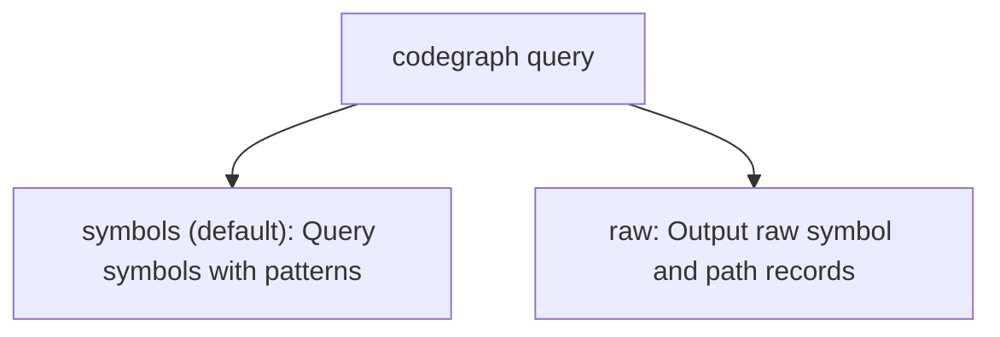

# Feature Implementation Plan: Query Filtering Engine (`--filter`)

**Plan Version:** 1.0 (Model Tag: `g37`)  
**Status:** Proposed / Ready for Review  
**Target Projects:** `CodeGraphMcp.Core`, `CodeGraphMcp.Cli`, `CodeGraphMcp.Server`, `CodeGraphMcp.Tests`  
**Related Specifications:** [`plan/query-filtering.md`](file:///d:/Projects/C%23/CodeGraphMcp/plan/query-filtering.md)

---

## 1. Executive Summary & Architectural Goals

The CodeGraph query infrastructure currently relies on basic substring or exact matching with SQL `LIMIT`/`OFFSET` pagination. While effective for simple lookups, complex search tasks (such as discovering all DTO request/response contracts, controller endpoints, interface hierarchies, or domain events across large codebases) require regex-like expressiveness without sacrificing sub-millisecond query performance.

This plan specifies a **Hybrid Pushdown Query Filtering Engine** that translates pattern expressions directly into native SQLite `WHERE` clauses (`LIKE`, `GLOB`, `OR`, `AND`) while gracefully falling back to a streaming chunked .NET `Regex.IsMatch` worker with **Keyset Cursor Pagination (`--cursor`)**.



### Core Design Objectives
1. **Maximized Database Pushdown**: Push 90%+ of common pattern patterns (wildcards, alternations, single-char matches, character classes) directly to SQLite engine to avoid transferring non-matching rows into managed memory.
2. **Zero-Duplicate, Zero-Gap Keyset Pagination**: Replace offset-based pagination (`OFFSET N`) with scanned-ID keyset cursors (`WHERE id > @cursor`) to guarantee deterministic pagination during chunked regex evaluations.
3. **Dirty Buffer Coherence**: Seamlessly evaluate in-memory uncommitted git modifications against the same filter rules.
4. **Agent-First CLI & MCP Contracts**: Provide unified CLI flags (`--filter` / `-f`, `--cursor` / `-c`, `--limit` / `-l`) and structured JSON payloads for AI agents alongside rich terminal views for human developers.

---

## 2. CLI Command Suite Specification

### 2.1. Unified Query Command Hierarchy
The `codegraph query` CLI command will support both targeted symbol queries and general filtered queries across symbols and files.



### 2.2. Command Options & Syntax

#### Syntax:
```bash
# Query symbols matching pattern
codegraph query [symbol-name] [--filter|-f <pattern>] [--repo|-r <path>] [--type|-t <type>] [--lang <language>] [--limit|-l <n>] [--cursor|-c <token>] [--json] [--referenced]

# Query raw symbol records (streamlined for scripting)
codegraph query raw --filter <pattern> [--repo|-r <path>] [--limit <n>] [--cursor <token>] [--json]
```

#### CLI Options:
| Flag | Short | Type | Default | Description |
|---|---|---|---|---|
| `symbol-name` | — | `string?` | `null` | Optional positional symbol name (legacy support / exact-substring match). |
| `--filter` | `-f` | `string?` | `null` | Pattern or regex expression to filter symbol names and paths. |
| `--repo` | `-r` | `DirectoryInfo?` | Current Dir | Target repository root directory. |
| `--type` | `-t` | `string?` | `null` | Filter by symbol type (e.g. `Class`, `Method`, `Interface`, `Property`, `Enum`, `Function`). |
| `--language` | `--lang` | `string?` | `null` | Filter by language (e.g. `csharp`, `typescript`, `html`, `json`, `yaml`, `powershell`). |
| `--limit` | `-l` | `int` | `500` | Max number of matching items to return (0 or negative for default 500 cap). |
| `--cursor` | `-c` | `long?` | `0` | Keyset pagination token (scanned database ID) to resume next page. |
| `--skip` | `--offset`| `int` | `0` | Traditional offset pagination (mutually exclusive with `--cursor`). |
| `--referenced` | `--with-references` | `bool` | `false` | Display caller/reference call sites for matched symbols. |
| `--json` | — | `bool` | `false` | Output machine-readable JSON structure for autonomous agent workflows. |

---

## 3. Pattern-to-SQL Transpilation Engine (`FilterTranspiler`)

### 3.1. Transpilation Grammar & Token Mapping Table

| Pattern Category | User Input (`--filter`) | Transpiled SQLite Clause | Engine |
|---|---|---|---|
| **Simple Substring** | `User` | `symbol_name LIKE '%User%' COLLATE NOCASE` | SQLite `LIKE` |
| **Prefix Match** | `^IUser` or `IUser*` | `symbol_name GLOB 'IUser*'` | SQLite `GLOB` |
| **Suffix Match** | `*Controller$` or `*Controller` | `symbol_name GLOB '*Controller'` | SQLite `GLOB` |
| **Infix Wildcard** | `User*Dto` | `symbol_name GLOB '*User*Dto*'` / `LIKE '%User%Dto%'` | SQLite `LIKE` / `GLOB` |
| **Single Character** | `Re.uest` | `symbol_name LIKE '%Re_uest%' COLLATE NOCASE` | SQLite `LIKE` |
| **Character Range** | `^I[A-Z].*` | `symbol_name GLOB 'I[A-Z]*'` | SQLite `GLOB` |
| **Alternation (Flat)** | `(Request\|Response\|Event)` | `(symbol_name LIKE '%Request%' OR symbol_name LIKE '%Response%' OR symbol_name LIKE '%Event%')` | SQLite `OR` |
| **Alternation (Grouped)**| `((.equest)\|(Response))` | `((symbol_name LIKE '%_equest%') OR (symbol_name LIKE '%Response%'))` | SQLite `OR` + Parentheses |
| **Anchored Alternation**| `^(Get\|Set)[A-Z]` | `(symbol_name GLOB 'Get[A-Z]*' OR symbol_name GLOB 'Set[A-Z]*')` | SQLite `GLOB` + `OR` |

### 3.2. Transpiler State Machine & AST Architecture

```mermaid
flowchart TD
    InputStr["Raw Filter String"] --> Lexer["FilterLexer: Tokenizes literals, wildcards, groups, alternations, char classes"]
    Lexer --> Parser["FilterAstParser: Builds AST Tree"]
    Parser --> Optimizer["AstOptimizer: Simplifies wildcards and distributes prefixes/suffixes"]
    Optimizer --> Classifier{"Can Translate to Pure SQL?"}
    
    Classifier -->|Yes| SqlGen["SqlGenerator: Emits Parameterized SQLite WHERE Clause + GLOB/LIKE parameters"]
    Classifier -->|No (Complex Regex)| RegexFall["RegexFallback: Compiles System.Text.RegularExpressions.Regex"]
```

### 3.3. Translatability & Fallback Detection Rules
The transpiler will immediately classify a pattern as requiring **Regex Fallback** if it contains constructs not natively expressible in SQLite ANSI/GLOB SQL:
1. **Lookaround assertions**: Lookahead `(?=...)`, `(?!...)`, Lookbehind `(?<=...)`, `(?<!...)`.
2. **Backreferences**: `\1`, `\k<name>`.
3. **Repetition quantifiers with ranges**: `{2,5}`, `+?`, `*?` (lazy matches).
4. **Word boundaries**: `\b`, `\B`.
5. **Unicode categories**: `\p{Lu}`, `\p{IsBasicLatin}`.
6. **Case-insensitive character classes in GLOB**: e.g., `GLOB '[a-z]'` in SQLite is case-sensitive, so if case-insensitivity is requested without explicit casing, convert to `LOWER(symbol_name) GLOB '[a-z]*'` or fallback.

---

## 4. Keyset Cursor Pagination & Streaming Fallback Engine

### 4.1. The Offset Pagination Bug & Resolution
In post-filtered queries, skipping $N$ records using SQL `OFFSET` causes severe drift:
- If 2,500 database rows are scanned to yield 500 regex matches, `--skip 500` will re-read rows $1 \dots 2500$ and yield duplicate matches from the previous page.
- Keyset cursor pagination uses the **Last Scanned Database ID (`scanned_cursor`)**:
  ```sql
  SELECT id, symbol_name, symbol_type, class_name, language, file_path, start_line, end_line, doc_comment
  FROM symbols
  WHERE id > @cursor
  ORDER BY id ASC
  LIMIT @batchSize;
  ```

### 4.2. Streaming Batch Algorithm

```csharp
public async IAsyncEnumerable<Symbol> StreamFilteredSymbolsAsync(
    string? sqlWhereClause,
    SqliteParameter[] parameters,
    Regex? fallbackRegex,
    long startCursor,
    int requestedLimit,
    [EnumeratorCancellation] CancellationToken ct = default)
{
    long currentCursor = startCursor;
    int matchedCount = 0;
    const int batchSize = 1000;

    while (matchedCount < requestedLimit && !ct.IsCancellationRequested)
    {
        var batch = await FetchBatchAsync(currentCursor, batchSize, sqlWhereClause, parameters, ct);
        if (batch.Count == 0) break;

        foreach (var sym in batch)
        {
            currentCursor = sym.Id;
            if (fallbackRegex is null || fallbackRegex.IsMatch(sym.SymbolName))
            {
                matchedCount++;
                yield return sym;
                if (matchedCount >= requestedLimit) break;
            }
        }
    }
}
```

### 4.3. Pagination Response Contract

#### CLI JSON Response Model (`QueryFilterResponse`):
```json
{
  "repoPath": "D:/Projects/C#/CodeGraphMcp",
  "filter": "((.equest)|(Response))",
  "transpiledToSql": true,
  "totalReturned": 500,
  "hasMore": true,
  "nextCursor": 2489,
  "symbols": [
    {
      "id": 102,
      "name": "GetOrderRequest",
      "type": "Class",
      "language": "csharp",
      "filePath": "src/Orders/GetOrderRequest.cs",
      "startLine": 12,
      "endLine": 45,
      "docComment": "/// <summary>Request DTO for fetching orders.</summary>",
      "isLive": false
    }
  ]
}
```

---

## 5. Architectural Components & Code Layout

```
src/
├── CodeGraphMcp.Core/
│   ├── Query/
│   │   ├── FilterTranspiler.cs           [NEW] AST tokenizer, optimizer & SQLite WHERE generator
│   │   ├── FilterAst.cs                  [NEW] AST node records (Literal, Wildcard, Group, Alternation)
│   │   ├── FilterTranspileResult.cs      [NEW] Encapsulates generated SQL, parameters, & fallback regex
│   │   └── QueryFilterOptions.cs         [NEW] Search filter parameters record
│   ├── Db/
│   │   └── Queries/
│   │       └── SymbolQueries.cs          [MODIFY] Add FindWithFilter & FetchBatchForCursor queries
│   └── Git/
│       └── DirtyFileBuffer.cs            [MODIFY] Add pattern/transpiler filtering support
├── CodeGraphMcp.Cli/
│   └── Commands/
│       ├── QueryCommandHandler.cs        [NEW] Dedicated CLI query handler with cursor/json options
│       ├── CommandFactory.cs             [MODIFY] Wire enhanced QueryCommandHandler into RootCommand
│       └── CliJsonContext.cs             [MODIFY] Register QueryFilterResponse in JSON serializer context
└── CodeGraphMcp.Server/
    └── Mcp/
        └── Tools/
            └── SearchCodebaseGraphTool.cs [MODIFY] Integrate FilterTranspiler & Keyset Cursor for pushdown
tests/
└── CodeGraphMcp.Tests/
    ├── FilterTranspilerTests.cs          [NEW] Unit tests for pattern transpilation & AST generation
    ├── SymbolQueriesFilterTests.cs       [NEW] Integration tests for keyset cursor & batch streaming
    ├── QueryCommandHandlerTests.cs       [NEW] CLI E2E tests for --filter, --cursor, and --json
    └── DirtyBufferFilterTests.cs         [NEW] Tests for live uncommitted pattern filtering
```

---

## 6. Detailed Component Implementation Details

### 6.1. `FilterTranspiler` (`CodeGraphMcp.Core/Query/FilterTranspiler.cs`)

```csharp
namespace CodeGraphMcp.Query;

public sealed record FilterTranspileResult(
    bool IsTranslatable,
    string? SqlClause,
    IReadOnlyList<SqliteParameter> Parameters,
    Regex? FallbackRegex,
    string OriginalPattern);

public static class FilterTranspiler
{
    public static FilterTranspileResult Transpile(
        string? pattern,
        string columnName = "symbol_name",
        string paramPrefix = "fp")
    {
        if (string.IsNullOrWhiteSpace(pattern))
        {
            return new FilterTranspileResult(true, null, Array.Empty<SqliteParameter>(), null, string.Empty);
        }

        // 1. Try parsing into AST
        if (FilterAstParser.TryParse(pattern, out var ast) && ast.CanTranslateToSql())
        {
            var parameters = new List<SqliteParameter>();
            var sqlClause = ast.ToSqlClause(columnName, paramPrefix, parameters);
            return new FilterTranspileResult(true, sqlClause, parameters, null, pattern);
        }

        // 2. Complex regex fallback
        var regex = new Regex(pattern, RegexOptions.IgnoreCase | RegexOptions.Compiled, TimeSpan.FromMilliseconds(500));
        return new FilterTranspileResult(false, null, Array.Empty<SqliteParameter>(), regex, pattern);
    }
}
```

### 6.2. `SymbolQueries.cs` Enhancements

```csharp
public sealed class SymbolFilterResult
{
    public required IReadOnlyList<Symbol> Symbols { get; init; }
    public long NextCursor { get; init; }
    public bool HasMore { get; init; }
}

public SymbolFilterResult FindWithFilter(
    FilterTranspileResult transpileResult,
    long cursor = 0,
    int limit = 500,
    string? language = null,
    SymbolType? symbolType = null)
{
    if (transpileResult.IsTranslatable)
    {
        // Execute direct pushdown query
        return ExecuteDirectPushdownQuery(transpileResult, cursor, limit, language, symbolType);
    }
    else
    {
        // Execute chunked streaming regex fallback query
        return ExecuteStreamingRegexFallback(transpileResult.FallbackRegex!, cursor, limit, language, symbolType);
    }
}
```

### 6.3. CLI Handler Integration (`QueryCommandHandler.cs`)
- Handles text formatting with ANSI colors and aligned columns.
- Renders hierarchical reference trees when `--referenced` is supplied.
- Produces zero-overhead AOT-compatible JSON with `CliJsonContext`.

---

## 7. Test & Verification Matrix

### 7.1. Transpiler Unit Tests (`FilterTranspilerTests.cs`)
1. **`Transpile_Alternations_GeneratesSqlOr`**:
   - Input: `"(Request|Response|Event)"`
   - Asserts: `IsTranslatable = true`, SQL contains `(symbol_name LIKE @fp0 OR symbol_name LIKE @fp1 OR symbol_name LIKE @fp2)`.
2. **`Transpile_SingleCharDot_GeneratesSqlUnderscore`**:
   - Input: `"((.equest)|(Response))"`
   - Asserts: Translates `.` to `_` in `LIKE` parameter.
3. **`Transpile_GlobRanges_GeneratesSqlGlob`**:
   - Input: `"^I[A-Z].*"`
   - Asserts: SQL contains `symbol_name GLOB 'I[A-Z]*'`.
4. **`Transpile_ComplexLookahead_TriggersRegexFallback`**:
   - Input: `"(?=.*Service)(?!.*Internal)"`
   - Asserts: `IsTranslatable = false`, `FallbackRegex != null`.
5. **`Transpile_SpecialCharactersEscaped_HandlesLiterals`**:
   - Input: `@"GetOrder\.Dto\*"`
   - Asserts: Properly distinguishes escaped `\.` from single-char `.`.

### 7.2. Keyset & Pagination Integration Tests (`SymbolQueriesFilterTests.cs`)
1. **`FindWithFilter_Pushdown_RespectsLimitAndCursor`**:
   - Seed 1,500 symbols into test SQLite DB.
   - Run page 1 with `limit: 500, cursor: 0`.
   - Run page 2 with `limit: 500, cursor: page1.NextCursor`.
   - Asserts: Page 1 and Page 2 contain mutually exclusive symbol IDs, continuous order, zero gaps.
2. **`FindWithFilter_RegexFallback_AccurateCountAndCursor`**:
   - Seed 2,500 symbols, where only every 3rd symbol matches regex fallback.
   - Request `limit: 200`.
   - Asserts: Exactly 200 matches returned; `NextCursor` points to the last scanned row ID.

### 7.3. CLI End-to-End Tests (`QueryCommandHandlerTests.cs`)
1. **`CliQuery_FilterWithOr_OutputsMatchingSymbols`**:
   - Executes `codegraph query --filter "(Request|Response)" --json`.
   - Validates JSON output structure and schema.
2. **`CliQuery_CursorPagination_SeamlessResume`**:
   - Executes `codegraph query --filter ".*" --limit 100 --json`.
   - Extracts `nextCursor` and executes next command with `--cursor <nextCursor>`.
   - Asserts zero duplicate IDs across pages.

---

## 8. Implementation Checklist & Phased Rollout

- [ ] **Phase 1: Transpiler & Grammar Engine**
  - Implement `FilterAst.cs`, `FilterAstParser.cs`, and `FilterTranspiler.cs` in `CodeGraphMcp.Core/Query/`.
  - Add comprehensive unit tests in `FilterTranspilerTests.cs`.
- [ ] **Phase 2: Database Keyset & Streaming Fallback**
  - Implement `FindWithFilter` and chunked cursor methods in `SymbolQueries.cs`.
  - Update `DirtyFileBuffer.cs` to filter dirty symbols with `FilterTranspileResult`.
  - Add integration tests in `SymbolQueriesFilterTests.cs` and `DirtyBufferFilterTests.cs`.
- [ ] **Phase 3: CLI Command Handler & Wiring**
  - Implement `QueryCommandHandler.cs` in `CodeGraphMcp.Cli/Commands/`.
  - Wire options into `CommandFactory.cs`.
  - Register DTOs in `CliJsonContext.cs`.
  - Add CLI E2E tests in `QueryCommandHandlerTests.cs`.
- [ ] **Phase 4: MCP Server Search Tool Pushdown**
  - Refactor `SearchCodebaseGraphTool.cs` to use `FilterTranspiler` and keyset cursors.
  - Run full test suite (`dotnet test`).
