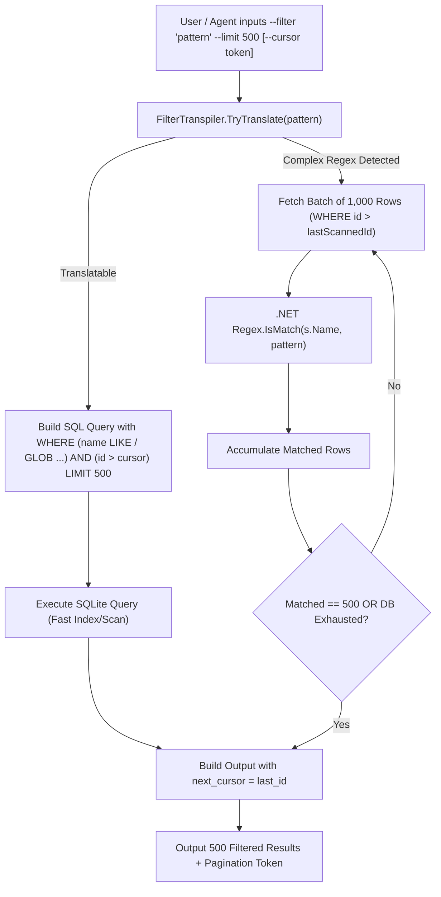

# Feature Specification: Query Filtering (`--filter`)

## 1. Overview & Objective

Provide rich pattern and regex-like filtering capabilities to CodeGraph CLI query commands (e.g., `codegraph query raw`, `codegraph query symbols`), allowing users and AI agents to filter symbol and file results efficiently.

To maximize execution speed and minimize memory overhead, the engine translates common pattern syntax (alternations, wildcards, single-character matches, character sets) directly into native SQLite `WHERE` clauses (`LIKE` / `GLOB` / `OR`). Complex regex constructs not translatable to SQL cleanly fall back to a streaming chunked in-memory .NET `Regex.IsMatch` filter with cursor-based pagination.

---

## 2. CLI Usage & Examples

```bash
# Filter for DTOs / messages (translated to SQL OR + LIKE)
codegraph query raw -r ./ --filter "((.equest)|(Response))"

# Filter multiple types
codegraph query symbols -r ./ --filter "(Request|Response|Event)"

# Filter interfaces starting with I (translated to SQLite GLOB '[A-Z]')
codegraph query symbols -r ./ --filter "^I[A-Z].*"

# Scoped with root path and limit
codegraph query raw -r ./src/Api --filter ".*Controller$" --limit 500

# Resuming next page via Cursor (prevents duplicates/skipped rows during post-filtering)
codegraph query raw -r ./src/Api --filter ".*Controller$" --limit 500 --cursor 2489
```

---

## 3. Pattern-to-SQL Translation Rules

| Input Pattern (`--filter`) | Target SQLite `WHERE` Clause | Notes |
|---|---|---|
| `"((.equest)\|(Response))"` | `((name LIKE '%_equest%') OR (name LIKE '%Response%'))` | `.` $\rightarrow$ `_`, `\|` $\rightarrow$ `OR` |
| `"(Request\|Response\|Event)"` | `(name LIKE '%Request%' OR name LIKE '%Response%' OR name LIKE '%Event%')` | Multi-way alternation |
| `"^I[A-Z].*"` | `(name GLOB 'I[A-Z]*')` | Native SQLite GLOB range support |
| `"Get*\|Set*"` | `(name GLOB 'Get*' OR name GLOB 'Set*')` | Wildcard prefix/suffix |
| `"User*Dto"` | `(name LIKE 'User%Dto')` | Infix wildcards |

### Token Mapping Table
- **Alternation (`|`)**: Maps to SQL `OR`
- **Single Character (`.`)**: Maps to SQL `_` (LIKE) or `?` (GLOB)
- **Wildcard (`*` or `.*`)**: Maps to SQL `%` (LIKE) or `*` (GLOB)
- **Grouping (`(...)`)**: Maps to SQL parenthesized expressions `(...)`
- **Character Classes (`[A-Z]`, `[0-9]`)**: Maps to SQLite `GLOB` brackets

---

## 4. Execution Pipeline & Fallback Architecture



---

## 5. Cursor-Based Pagination (Preventing Duplicates & Gaps)

### The Problem with Offset Pagination in Post-Filtering
If the system scanned 2,500 database rows to find 500 regex matches, an offset-based `--skip 500` would either:
1. Skip 500 *database rows* (re-reading 2,000 previously evaluated rows and returning duplicate results).
2. Skip 500 *matches* (requiring re-evaluating the previous 2,500 rows from the beginning of the table).

### The Solution: Scanned-ID Cursor (`--cursor` / `next_cursor`)
Every response payload includes pagination metadata containing the **last evaluated database ID**:

```json
{
  "total_returned": 500,
  "has_more": true,
  "next_cursor": 2489,
  "items": [
    { "name": "GetOrderRequest", "filePath": "Orders/Dto.cs", "lineNumber": 14 },
    ...
  ]
}
```

* **CLI Next Page**: `codegraph query raw --filter ".*Request" --limit 500 --cursor 2489`
* **Zero Duplicates & Zero Gaps**: The database query immediately begins at `WHERE id > 2489`, picking up exactly where the previous scan finished.

---

## 6. Implementation Design

### File Locations
- `src/CodeAtlas.Core/Query/FilterTranspiler.cs`: Core token parser and SQL generator.
- `src/CodeAtlas.Core/Db/Queries/SymbolQueries.cs`: Keyset cursor querying (`WHERE id > @cursor`) and streaming fetch.
- `src/CodeAtlas/Commands/QueryCommand.cs`: CLI option parsing (`--filter` / `-f`, `--limit`, `--cursor`).

---

## 7. Benefits
- **Optimal Speed**: Standard queries avoid allocating memory for non-matching rows.
- **Accurate Limits**: Guaranteed to return the requested number of matching items even when using in-memory regex fallback.
- **Deterministic Pagination**: Cursor tokens guarantee zero duplicates and zero skipped rows across page boundaries.
- **Single CLI Option**: Users and agents do not need to choose between `--filter` and `--filter-regex` flags.
